# 💰 High-Frequency FinTech Streaming Ingestion & Compliance Core

An enterprise-grade, high-throughput asynchronous financial telemetry pipeline engineered to consume real-time crypto asset ticks, execute token-bucket rate limiting compliance, and apply zero-knowledge cryptographic masking at institutional scale.

## ✨ Implemented Architectural Features:
* **Concurrent Multi-Threaded Ingestion:** Spawns asynchronous worker pools (`ThreadPoolExecutor`) to parse and route high-density streaming ticks simultaneously across parallel cluster lanes.
* **Zero-Knowledge Cryptographic Anonymizer:** Executes a military-grade SHA-256 hashing algorithm combined with a secure deployment salt to fully obfuscate institutional account names for strict banking compliance.
* **Token-Bucket Rate Limiter Compliance:** Integrates an advanced token-bucket tracking matrix to dynamically pace transaction velocity, preventing API blacklisting during high-frequency trading bursts.
* **Automated Financial Unit Test Suite:** Built a comprehensive validation harness checking algorithmic volatility drops, transaction data quality, and safe database ledger syncs.
* **Dynamic Database Schema Evolution:** Provisions an automated schema migration core (`database_server.py`) to patch and update active production tables to v2.0.0 with 0% trading downtime.
* **Performance Telemetry & Cluster Orchestration:** Combines Prometheus SRE metrics configs (`prometheus_metrics.yml`) with a multi-node Docker Compose network grid (`docker-compose.yml`) for absolute scalability.

## 🛠️ System Tools & Architecture
* **Language Core:** Python 3.x (Multi-Threaded Concurrency Node)
* **Infrastructure Virtualization:** Docker Multi-Node Cluster Blueprint Matrix
* **Automated DevOps Pipeline:** GitHub Actions Continuous Integration (CI) Cloud Machine Logs

## 📐 System Topology & Financial Data Vector Matrix

```mermaid
graph TD
    A[📈 High-Frequency Crypto Feed] -->|Asynchronous JSON Bursts| B(⚡ Multi-Threaded Worker Pools)
    B --> C{🛡️ Token Bucket Compliance}
    C -->|If Rate Exceeded| D[⚠️ Compliance Block Drop]
    C -->|Pass Traffic| E{🔒 Cryptographic Shield}
    E -->|SHA-256 Salted Hash| F[👤 Masked Account Token]
    B --> G{📊 Algorithmic Risk Analytics}
    G -->|If Price Delta >= 5%| H[🚨 Volatility Quarantine Queue]
    G -->|Stable Price Metric| I[💾 Verified Transaction Ledger]
    I --> J[⚙️ Schema Migration Layer v2.0.0]
    J --> K[📝 Live Skyhook DB Core]

    style A fill:#0f172a,stroke:#38bdf8,stroke-width:2px,stroke-dasharray: 5 5
    style B fill:#1e1b4b,stroke:#818cf8,stroke-width:2.5px
    style C fill:#31102f,stroke:#f43f5e,stroke-width:2px
    style G fill:#1c2d37,stroke:#34d399,stroke-width:2px
    style H fill:#450a0a,stroke:#ef4444,stroke-width:3px
    style K fill:#064e3b,stroke:#059669,stroke-width:2px
```

